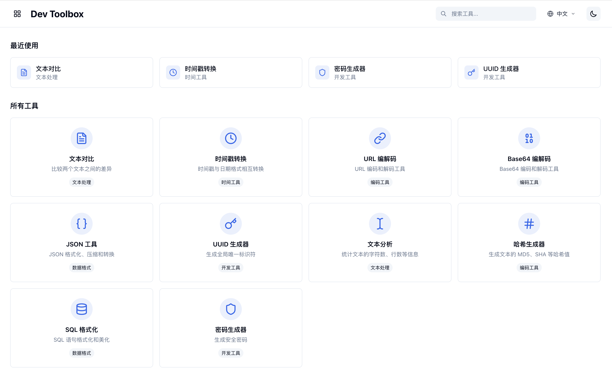
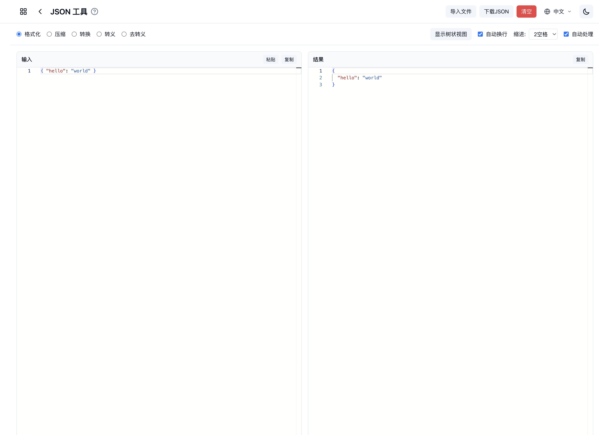

# Dev Toolbox

<div align="center">

**A Modern Web Application with Essential Developer Tools**

[](https://opensource.org/licenses/MIT)
[](https://nodejs.org/)
[](https://vuejs.org/)
[](https://www.typescriptlang.org/)

English | [简体中文](README_ZH.md)

</div>

## 🚀 Features

### Core Tools

- 📝 **Text Diff Tool** - Monaco Editor based, supports side-by-side/inline comparison, syntax highlighting, difference navigation
- 🔤 **Base64 Encoder/Decoder** - Standard and URL-safe modes, file processing, real-time conversion
- 📄 **JSON Toolkit** - Format, minify, validate, JSON↔YAML↔XML conversion, JSONPath query, tree view
- 🔗 **URL Encoder/Decoder** - Multiple encoding modes, real-time processing
- ⏰ **Smart Timestamp Converter** - Intelligent recognition of multiple time formats, standard format output
- 🔑 **UUID Generator** - Generate standard UUID v4
- 📊 **Text Analyzer** - Real-time statistics for characters, lines, paragraphs
- 🔒 **Hash Generator** - Support MD5, SHA series algorithms
- 🗃️ **SQL Formatter** - Multi-database SQL beautification tool
- 🔐 **Password Generator** - Multiple password types with security strength analysis

### Product Highlights

✨ **Modern Interface** - Monaco Editor based, professional code editing experience
🎨 **Unified Design** - Consistent UI/UX design, smooth interaction experience
🌙 **Dark Mode** - System adaptive theme, eye-friendly
⚡ **High Performance** - Real-time processing, responsive
💾 **Data Persistence** - Auto-save user settings and history
🌐 **Web-based** - Access from any browser, no installation required

## 📸 Preview





## 🛠️ Tech Stack

- **Frontend Framework**: Vue 3 + TypeScript
- **Build Tool**: Vite 5
- **UI Framework**: TailwindCSS 3
- **Editor**: Monaco Editor (VS Code Core)
- **State Management**: Pinia
- **Utilities**: dayjs, crypto-js, json5, lossless-json, xml-js, sql-formatter, marked + DOMPurify, etc.

## 🌐 Online Access

Experience Dev Toolbox directly in your browser:

**Official Website**: [https://dev-toolbox.vercel.app](https://dev-toolbox.vercel.app)

> No installation required, works on all platforms with a modern browser

## 📦 Local Development

### Requirements

- Node.js 20.19+ (22 LTS recommended)
- npm 9+

### Clone Repository

```bash
git clone https://github.com/your-username/dev-toolbox.git
cd dev-toolbox
```

### Install Dependencies

```bash
npm install
```

### Development Mode

```bash
npm run dev
```

The app will be available at `http://localhost:5173`

### Build for Production

```bash
# Build the application
npm run build

# Preview the build
npm run preview
```

## 🎯 Usage Guide

### Getting Started

1. Visit the online version or run locally
2. Select the tool you need from the main interface
3. Start using the tools immediately
4. Your preferences are automatically saved

### Keyboard Shortcuts

- `Cmd/Ctrl + V`: Paste text
- `Cmd/Ctrl + C`: Copy result
- `Cmd/Ctrl + A`: Select all
- `Cmd/Ctrl + Z`: Undo
- `Cmd/Ctrl + Shift + Z`: Redo

### Tool Instructions

Each tool page provides detailed usage instructions and examples. Click the "?" icon to view help information.

## 🤝 Contributing

We welcome contributions of any kind! Please see [Contributing Guide](CONTRIBUTING.md) for details.

### Quick Start Contributing

1. Fork this repository
2. Create feature branch (`git checkout -b feature/AmazingFeature`)
3. Commit changes (`git commit -m 'Add some AmazingFeature'`)
4. Push to branch (`git push origin feature/AmazingFeature`)
5. Create Pull Request

### Report Issues

If you find bugs or have feature suggestions:

1. Check [existing Issues](../../issues) to ensure the issue hasn't been reported
2. Create a new issue using appropriate [Issue templates](../../issues/new/choose)
3. Provide detailed reproduction steps and environment information

## 📝 Changelog

See [CHANGELOG.md](CHANGELOG.md) for version update details.

### Latest Version Highlights

- ✨ New Monaco Editor integration
- 🎨 Unified UI/UX design
- 🚀 Performance optimization and stability improvements
- 🛠️ Added multiple practical tools

## 📄 License

This project is open source under [MIT License](LICENSE).

## 🙏 Acknowledgments

Thanks to the following open source projects:

- [Vue.js](https://vuejs.org/) - Progressive JavaScript Framework
- [Monaco Editor](https://microsoft.github.io/monaco-editor/) - Powerful Code Editor
- [TailwindCSS](https://tailwindcss.com/) - Utility-first CSS Framework
- [Vite](https://vitejs.dev/) - Fast Build Tool

## 📞 Support

If you like this project, please consider:

- ⭐ Star the project
- 🐛 Report issues and suggestions
- 🔧 Contribute code
- 📢 Recommend to other developers

---

<div align="center">

**Make Development More Efficient, Make Tools Better**

</div>
